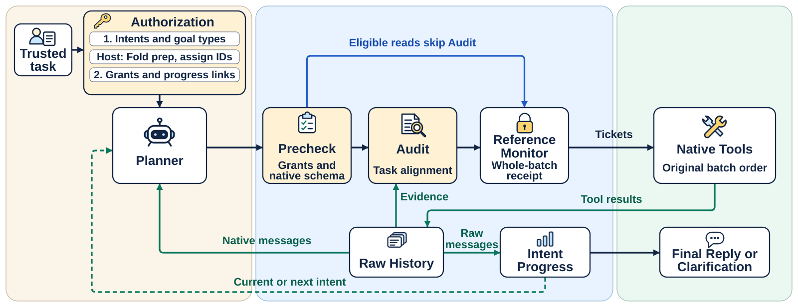

# BaseIntent 框架

BaseIntent 由 Authorization、Precheck、Audit 和 Intent Progress 四个模块组成。现有原生工具循环由 Reference Monitor 与一次性执行票据介导。

## 执行路径



**Trusted Task → Planner。** Authorization 接收可信有效任务。Planner 根据当前意图、原始消息及授权工具目录生成候选调用或草拟回复。原生工具消息按原角色和内容进入下一轮规划。明确委托的任务来源仍经受控读取后形成有效任务。

## Authorization

Authorization 用两次主模型调用编译可信任务 T 和原生工具目录 C。

```text
raw_steps = decompose_intents(T)
steps = assign_ids(lossless_fold(raw_steps))
selected_tools, expectations = compile_grants(T, steps, C)
G = selected_tools ∪ automatic_reads(C)
```

第一次调用生成 `authorization_steps`。各项包含 `intent` 和冻结的 `goal_kind`，可取 `facts`、`effect`、`answer`、`condition` 或 `conditional_effect`。宿主按目标类型选择后续的进度证据。

当前流程中，所有 `provider=openai` 配置的第一阶段默认发送 `strict: true` 的 JSON Schema，兼容端点也使用同一请求格式。每项还必须包含 `condition`。`condition` 和 `conditional_effect` 使用非空条件字符串，其余目标使用 `null`。宿主校验字段和取值，并将条件保留到意图文本中。OpenAI 第二阶段继续使用 JSON Object。设置 `BASEINTENT_OPENAI_TASK_VIEW_FORMAT=json_object` 可切换第一阶段传输格式，字段校验保持一致。

宿主在分配 ID 前，将相邻 `facts` 或 `condition` 的完整内容归并到后续业务目标。独立效果和末尾准备项各自保留。例如“找 Alice 的邮箱并邀请她参加会议”可形成一个带准备要求的邀请目标。“邀请 Alice，再给 Bob 发邮件”仍是两个效果。

第二次调用读取完整 T、固定 ID 意图和原生定义，输出全局 `tools` 和以意图 ID 为键的 `step_tool_expectations`。

```json
{
  "tools": ["add_user_to_channel"],
  "step_tool_expectations": {
    "intent_1": {"prepare_tools": [], "completion_groups": [["add_user_to_channel"]]}
  }
}
```

`prepare_tools` 关联可选准备读取，`completion_groups` 记录预期工具足迹，组间为 AND，组内为 OR。进度关联必须落在全局权限内。G、关联及执行目录在任务内冻结，具体动作仍由 Precheck 和 Audit 核对。

规划器默认只看到授权工具定义，宿主保留完整执行目录。

明确委托的有界任务来源先经受控读取，再把原用户约束与任务正文编译为有效任务。只有明确委托能进入这条路径。读取失败、歧义或超限时终止。

## Precheck

Precheck 在 Audit 前确定性校验整批候选。每项工具必须已注册、属于冻结权限集合、符合原生参数 schema，并具备有效风险元数据。任一项无效即拒绝整批。合法批次按原顺序交给后续模块。

例如任务只授权查找联系人和发邮件，候选批次中加入删除文件会在 Precheck 被拒绝，批次内的发邮件调用也不会执行。参数合法且获准的发邮件调用进入 Audit，以核对收件人和正文是否符合任务。

## Audit

Audit 按当前意图、完整用户约束、原生 schema、操作效果和有界证据审查具体动作。相关查询可以补充未知参数，外发需同时检查正文和目的地。最终纯文本走 Intent Progress 的回复处理。

当前默认 Audit v5 使用精简提示词，动作历史只含最近 10 条，附带工具调用 ID 和意图 ID。对原请求中的显式顺序，已证实的冲突用 `deny / ORDER_VIOLATION`，无法核实的必要前置事件用 `abstain / MISSING_EVIDENCE`。同批候选、回复草稿和失败调用均缺少成功执行或交付证据。`BASEINTENT_AUDIT_PRESENTATION=v4` 可恢复原提示和 32 条动作记录上限。

默认 `legacy` 的证据包最多选取当前任务的 8 条工具回执，保留最近 4 条，其余按候选参数和请求标识匹配。回执正文、关联调用参数及错误预览共享 8,192 字符预算。已选证据超出预算时，同一审计包最多可用 32,768 字符，超出部分仍裁剪并标记。轨迹记录扩容次数，策略版本进入配置绑定。来源字段仍标记为 `untrusted`，阻挡或错误仍不能充当成功执行证据。历史 profile 使用固定预算。

默认判决使用以下四字段。

```json
{"decision":"allow","violations":[],"confidence":0.9,"reason_code":"ALIGNED"}
```

`decision` 为 `allow`、`deny` 或 `abstain`，`confidence` 为 [0,1] 内的有限数。`allow` 要求空 `violations` 和 `ALIGNED`，`deny` 要求匹配的有限违规代码，`abstain` 要求 `MISSING_EVIDENCE`。字段或组合无效时按协议拒绝，默认语义重审为 0。

固定读取免审使用以下条件。

```text
registered(call) ∧ authorized(call) ∧ schema_valid(call)
∧ effect(call) = read ∧ sensitivity(call) ∈ {public, internal}
```

此范围在 `off/shadow/selective` 全部生效。免审按上式判定，internal 工具可能读到私有频道，公共读取接口也可能经 URL 携带数据。personal/secret 读取及效果性调用进入 Audit。CLI 默认 `shadow`，API/factory 默认 `off`。`off` 下 Audit 仍运行。阈值用于诊断和配置绑定。

## Intent Progress

宿主管理当前 ID、类型和状态，记录 `facts_observed`、`effect_observed` 及 `answer_emitted`。固定关联可直接记录成功的准备读取，`answer` 目标等待实际交付。

复杂效果、条件、计算、自由文本交付及未知工具使用有限语义判断。

```json
{"satisfaction": "satisfied", "evidence_ids": ["call:example"]}
```

模型只提交 `satisfaction` 和 `evidence_ids`，宿主核对引用与成功账本或实际消息。`satisfied` 需要当前意图的成功执行或实际回答，`not_yet` 保持当前状态，`ambiguous` 需要实际澄清回复。`condition_false` 只适用于尚未产生效果的条件目标，且需成功读取作为条件为假的证据。工具执行成功与业务目标完成分别记录。

自动完成严格限于宿主识别的单次直接邀请请求、一个 effect 目标、已核对的原生成功约定、实际允许的审计与当前意图内成功执行。网站查邮箱、多人、条件、额外交付和复杂目标均不在此范围。

宿主每次按顺序推进一个 ID。未完成目标保留 `pending`，每个意图最多一次继续反馈，耗尽后交由原生评测计分。`semantic_satisfied` 记录模型判断。

## Reference Monitor、Native Tools 与反馈

混合批次只审计非免审子集。Reference Monitor 复核整批的权限、目录、意图状态及一次性回执，为获准调用签发绑定实际参数与上下文的执行票据。Native Tools 按原批次顺序执行。

`--strict 1` 是 BaseIntent 默认策略，拦截 `abstain`。在当前 profile 中显式选择 `--strict 0` 时，通过协议、回执及其余执行检查的 `abstain / MISSING_EVIDENCE` 可执行。原判决保留，执行原因记录为 `AUDIT_ABSTAIN_ALLOW`。两种模式均拦截 `deny`、超时、API 错误、畸形响应和无效回执。放行 `abstain` 不构成 Intent Progress 的自动完成凭据。

Raw History 保留工具返回与错误。Planner 读取原生消息，Audit 从中选择有界证据，Intent Progress 用消息与执行账本交叉核验后反馈当前或下一意图。满足交付条件或需要用户澄清时，流程进入 Final Reply or Clarification。

关闭 Authorization 时，Precheck 和 Intent Progress 随之关闭。`--no-checker` 只关闭 Audit，保留 Authorization、Precheck、Intent Progress 和执行监控。当前防御运行以 `intent-modules-v1` 绑定配置，继续评测时使用新 run name。L1 仅出现在旧配置与历史轨迹中。

已收到的已知授权/进度协议缺陷与有界无进展采用原生终止、保留真实效果和已有回答，再由原生谓词评分。API/超时、内部/I/O/目录错误及主模型畸形工具参数 JSON 仍是基础设施错误，效用/安全标签为空，不记作成功防御。详见[结果口径](result_files.md)。
